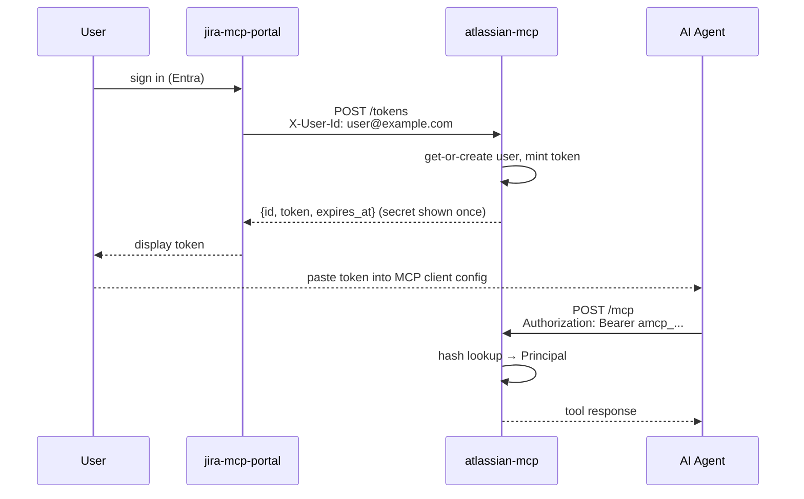
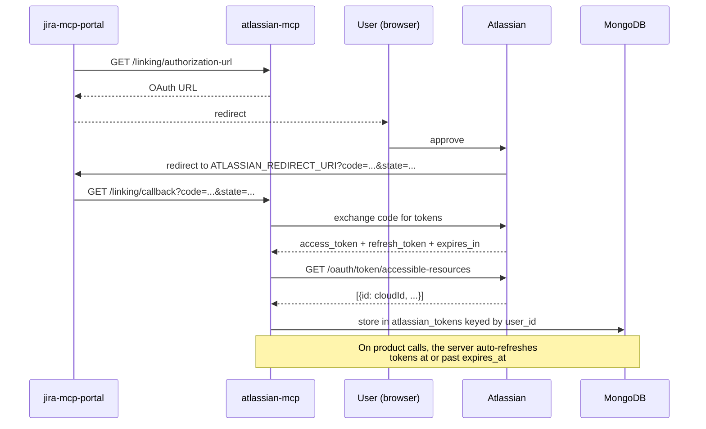

# atlassian-mcp

An MCP (Model Context Protocol) server that exposes [Jira](https://www.atlassian.com/software/jira) and [Confluence](https://www.atlassian.com/software/confluence) content to AI agents, behind a governed access-approval workflow. AI agents connect at `/mcp` using a bearer token and call MCP tools to search issues, read an issue, list pages, or read a page. The Atlassian account itself is connected up front through the portal, not by the agent.

Access is granted per **space or project key**, and separately **per product**: an Information Asset Owner can approve a space for Jira and refuse it for Confluence, or the other way round.

The companion frontend is [jira-mcp-portal](../jira-mcp-portal), which is the only intended caller of the REST surface described below.

There are two entry points over the same Jira and Confluence tools:

| | `atlassian-mcp-http` | `atlassian-mcp` |
| :--- | :--- | :--- |
| Transport | Streamable HTTP at `/mcp` | stdio, launched by a local MCP client |
| Caller identity | Personal access token per user | None: one local user |
| Atlassian credentials | Each user's OAuth (3LO) link, via the portal | Your own API token (classic or scoped) |
| Allowlist | `config_list` (from config) or `allow_list` (per-user approvals via the portal) | From config only |
| Needs | MongoDB, the portal, the `http` extra | Nothing else |

Most of this README describes the HTTP server. For the local stdio server, see [Local stdio server](#local-stdio-server-atlassian-mcp).

## Requirements

- Python `>= 3.13`
- [uv](https://docs.astral.sh/uv/)
- Docker (for local MongoDB; HTTP server only)

The stdio server needs only Python and uv.

## Local stdio server (`atlassian-mcp`)

Runs on your machine, started by your MCP client (Claude Desktop, Claude Code, or any stdio MCP client). It reads Jira and Confluence with your own Atlassian API token, and only within the projects and spaces you list.

### 1. Create a config file

Copy [`.env.example.stdio`](.env.example.stdio) to `~/.config/atlassian-mcp/.env` (on Windows, `%APPDATA%\atlassian-mcp\.env`) and fill it in:

```bash
mkdir -p ~/.config/atlassian-mcp
cp .env.example.stdio ~/.config/atlassian-mcp/.env
chmod 600 ~/.config/atlassian-mcp/.env
```

| Variable | Required | Meaning |
| :--- | :--- | :--- |
| `ATLASSIAN_SITE_URL` | yes | Your site, e.g. `https://your-site.atlassian.net` |
| `ATLASSIAN_EMAIL` | yes | The email address of the Atlassian account that owns the token |
| `ATLASSIAN_API_TOKEN` | yes | An [API token](https://id.atlassian.com/manage-profile/security/api-tokens) |
| `ATLASSIAN_API_TOKEN_TYPE` | no | `classic` (default) or `scoped`. Scoped tokens go through `api.atlassian.com`; the site's cloud id is looked up from the site URL at startup |
| `RESOURCE_GUARD_ALLOWED_JIRA_PROJECTS` | one of these two | Comma-separated Jira project keys, e.g. `FARM,AICE` |
| `RESOURCE_GUARD_ALLOWED_CONFLUENCE_SPACES` | one of these two | Comma-separated Confluence space keys, e.g. `ENG` |
| `ATLASSIAN_SKIP_STARTUP_CHECK` | no | `true` to skip the startup credential check (e.g. offline) |
| `LOG_LEVEL` | no | `DEBUG`, `INFO` (default), `WARNING` or `ERROR` |
| `REQUEST_TIMEOUT_SECONDS` | no | Default `30` |
| `HTTP_PROXY` | no | Proxy URL for calls to Atlassian |

The server refuses to start if both allowlists are empty. Keys are matched exactly and case-sensitively; wildcards and malformed keys are rejected at startup.

**Where configuration is read from**, highest precedence first:

1. Environment variables of the process (for example an MCP client's `env` block).
2. The file passed with `--env-file PATH`. If the flag is given, the file must exist.
3. If no `--env-file` is given: `$XDG_CONFIG_HOME/atlassian-mcp/.env`, defaulting to `~/.config/atlassian-mcp/.env`, or `%APPDATA%\atlassian-mcp\.env` on Windows, if it exists.

A `.env` in the current working directory is **never** read: MCP clients start servers from a directory you do not choose.

### 2. Add it to your MCP client

The simplest way is [`uvx`](https://docs.astral.sh/uv/guides/tools/), pinned to a commit of this repository. You don't need a checkout, and `uvx` installs only what stdio needs (no FastAPI or MongoDB).

Pin a full 40-character commit SHA, not a branch. A branch moves, so your client would run new code without you choosing to. To find the latest commit on `main`:

```bash
git ls-remote https://github.com/DEFRA/defra-atlassian-mcp main
```

Add the server to your MCP client's config file, for example `.mcp.json` in a project for Claude Code, or `claude_desktop_config.json` for Claude Desktop. Replace `<commit-sha>` with the SHA:

```json
{
  "mcpServers": {
    "atlassian": {
      "command": "uvx",
      "args": [
        "--from",
        "git+https://github.com/DEFRA/defra-atlassian-mcp@<commit-sha>",
        "atlassian-mcp"
      ]
    }
  }
}
```

Or, for Claude Code from the command line:

```bash
claude mcp add atlassian -- uvx --from git+https://github.com/DEFRA/defra-atlassian-mcp@<commit-sha> atlassian-mcp
```

The first start takes a few seconds while `uvx` builds the package. After that it starts from uv's cache. To upgrade, change the SHA.

To keep the config file somewhere else, add `"--env-file", "/path/to/atlassian-mcp.env"` after `"atlassian-mcp"`. Keeping the token in a file rather than in the client's config keeps it out of a file that is often shared or synced. Don't put the token in the `env` block of a project's `.mcp.json`, which is usually committed.

`uvx` resolves dependencies fresh. It doesn't read this repository's `uv.lock` or the security pins in `[tool.uv] constraint-dependencies`, so it may install newer versions of dependencies than CI tested. If you need the locked versions, use a checkout instead.

#### Or run it from a checkout

```json
{
  "mcpServers": {
    "atlassian": {
      "command": "uv",
      "args": ["--directory", "/path/to/defra-atlassian-mcp", "run", "atlassian-mcp"]
    }
  }
}
```

`uv run` installs the dev group, which is more than stdio needs. For a lean install, run `uv sync --no-dev` once in the checkout and use `/path/to/defra-atlassian-mcp/.venv/bin/atlassian-mcp` as the command instead.

#### Or run it from the Docker image

Build the image as described in [Building the Docker images](#building-the-docker-images):

```bash
docker build --target stdio --tag atlassian-mcp-stdio .
```

Point your MCP client at `docker` instead of `uv`. Use `-i` so stdin stays open, and never `-t`: a TTY would corrupt the protocol stream on stdout.

```json
{
  "mcpServers": {
    "atlassian": {
      "command": "docker",
      "args": ["run", "-i", "--rm", "--env-file", "/path/to/atlassian-mcp.env", "atlassian-mcp-stdio"]
    }
  }
}
```

Docker's `--env-file` reads the same `KEY=VALUE` file as `.env.example.stdio`. Don't put quotes around values, because Docker keeps them. Alternatively, mount your config directory with `-v ~/.config/atlassian-mcp:/home/nonroot/.config/atlassian-mcp:ro` and drop `--env-file`.

Inside the container, TLS verification uses the image's CA certificates, not your machine's. If you are behind a proxy that inspects TLS, the `uv` route above is simpler.

### 3. Check it

On startup the server checks your credentials. If Atlassian answers 401, it stops with a message saying which settings to check. It also warns about any listed key that does not resolve: usually a typo, or a project you cannot see. Other failures (an outage, a 403) are warnings only. Startup messages and logs go to **stderr**, which MCP clients show in their server log. stdout carries only the MCP protocol.

Ask the agent to call `list_allowed_keys` to confirm what it can read.

### The allowlist is a guardrail, not a security boundary

In stdio mode you hold the API token. The allowlist stops an agent wandering outside the projects and spaces you meant it to use, but anyone with the token, including you, can call Atlassian directly. **Your own Atlassian permissions are the real limit** on what can be read. Treat the token as you would your password. On the HTTP server, where the server holds each user's credentials and callers cannot reach Atlassian directly, the allowlist is enforced as a boundary.

## Setup (HTTP server)

```bash
uv sync
cp .env.example .env  # then fill in ATLASSIAN_CLIENT_ID, ATLASSIAN_CLIENT_SECRET, ATLASSIAN_REDIRECT_URI, BASE_URL
```

`uv sync` installs the dev group, which includes the `http` extra, so both entry points and the full test suite work from one environment.

### Dependencies

The package is split so the stdio entry point can be installed without the HTTP server's stack:

| Install | Contains | Used by |
| :--- | :--- | :--- |
| core (`uv sync --no-dev`) | `dishka`, `fastmcp`, `httpx2`, `pydantic-settings`, `truststore` | `atlassian-mcp` (stdio) |
| `--extra http` | adds `fastapi`, `uvicorn`, `pymongo`, `ecs-logging`, `asgi-logger` | `atlassian-mcp-http`, the Docker image |

Security pins for transitive dependencies (`cryptography`, `dnspython`, `joserfc`, `pyjwt`, `python-multipart`) are uv `constraint-dependencies`: they pin a package only when something else pulls it in. A plain `pip install` ignores them, so install with uv.

## Configuration

The app is configured via environment variables, managed by Pydantic `BaseSettings` in `app/config/` (`http.py` for this server, `base.py` for settings shared with the stdio entry point). See `.env.example` for a filled-in starting point.

| Variable | Default | Description |
| :--- | :--- | :--- |
| `BASE_URL` | *(required)* | Public base URL of this server |
| `SERVER_NAME` | `atlassian-mcp` | Name reported by the MCP server |
| `PYTHON_ENV` | `None` | Set to `development` to enable hot-reload |
| `HOST` | `127.0.0.1` | Server host |
| `PORT` | `8085` | Server port |
| `LOG_CONFIG` | `None` | Path to a uvicorn logging config file |
| `MONGO_URI` | `None` | MongoDB connection URI |
| `MONGO_TRUSTSTORE` | `TRUSTSTORE_CDP_ROOT_CA` | Env var name holding a custom CA cert for the Mongo TLS connection, if set |
| `AWS_ENDPOINT_URL` | `None` | AWS endpoint override, e.g. for LocalStack in local dev |
| `HTTP_PROXY` | `None` | Outbound HTTP proxy URL |
| `TRACING_HEADER` | `x-cdp-request-id` | Request tracing header name |
| `RESOURCE_GUARD_MODE` | `config_list` | `config_list` denies a space unless its key is listed, per product, in the two CSV vars below — see [Config-driven resource guard](#config-driven-resource-guard). `allow_list` denies unless an approved request exists for the (user, space, product) triple — see [Space access requests](#space-access-requests). Any other value fails at startup; there is no allow-everything mode |
| `RESOURCE_GUARD_ALLOWED_JIRA_PROJECTS` | *(required)* | Comma-separated Jira project keys allowed under `config_list` mode. May be set empty, but must be present — the server fails to start otherwise |
| `RESOURCE_GUARD_ALLOWED_CONFLUENCE_SPACES` | *(required)* | Comma-separated Confluence space keys allowed under `config_list` mode. May be set empty, but must be present — the server fails to start otherwise |
| `REST_AUTH_MODE` | `trusted` | `trusted` (network-asserted `X-User-Id` header) or `token` (personal access token) for REST/admin routes. Any other value fails at startup. `/mcp` and `/tokens` are unaffected — see [Auth](#auth) |
| `TRUSTED_USER_HEADER` | `X-User-Id` | Header the portal uses to assert the caller in `trusted` mode |
| `IDENTITY_DEFAULT_TTL_DAYS` | `90` | Default token lifetime |
| `IDENTITY_MAX_TTL_DAYS` | `365` | Longest lifetime a caller may request |
| `IDENTITY_LAST_USED_THROTTLE_SECONDS` | `300` | Minimum interval between `last_used_at` writes for the same token |
| `ATLASSIAN_AUTH_BASE` | `https://auth.atlassian.com` | Host serving the OAuth authorize and token endpoints |
| `ATLASSIAN_API_BASE` | `https://api.atlassian.com` | Host serving the product APIs and `/me` |
| `ATLASSIAN_CLIENT_ID` | *(required)* | Atlassian OAuth app client ID |
| `ATLASSIAN_CLIENT_SECRET` | *(required)* | Atlassian OAuth app client secret |
| `ATLASSIAN_REDIRECT_URI` | *(required)* | Absolute callback URL registered on the OAuth app. It points at the **portal**, not at this server — see [Atlassian OAuth](#atlassian-oauth-20-3lo-server--atlassian) |

Everything else about the Atlassian OAuth flow (authorize/token paths, audience, scopes), the Mongo database name, and every Mongo collection name is fixed in code, not configuration — there is exactly one value that would ever be used in any deployment.

Personal access tokens are always prefixed `amcp_`; that prefix is a code constant, not configuration, since changing it in production would invalidate every previously-minted token's prefix.

Local development uses a single root `.env` file, loaded by both `compose.yaml` and Pydantic directly. `.env` is gitignored.

## MCP Tools

Both entry points expose the four Jira and Confluence tools below. On the HTTP server they act for the caller identified by their personal access token (see [Auth](#auth)); no `user_id` parameter is passed explicitly. The allowlist check runs before any call to Atlassian.

- **`list_spaces()`** — HTTP only. Lists the spaces and project keys the caller has requested, with the approval status of each for Jira and Confluence. The natural first call in `allow_list` mode: it tells an agent what it is allowed to read.
- **`list_allowed_keys()`** — stdio, and HTTP in `config_list` mode. Lists the Jira project keys and Confluence space keys in the configured allowlist.
- **`search_jira_issues(project_key, text=None, status=None, limit=25)`** — Searches issues in a project, most recently updated first. JQL is built server-side; the caller never supplies it.
- **`get_jira_issue(issue_key)`** — Returns one issue's fields and description. The key must be exactly `PROJECT-123`; anything else is refused before any call. The allowlist is checked against the key's prefix (`FARM-123` → `FARM`), and the project on the returned issue is checked again, because Jira resolves the old key of a moved issue to its new project.
- **`list_confluence_pages(space_key, query=None, limit=25)`** — Lists pages in a space, most recently modified first.
- **`get_confluence_page(space_key, page_id)`** — Returns one page's content as text. The space key is a parameter so the allowlist can be checked before the page is fetched; the page is then verified to actually live in that space. The page id must be digits.

Connecting an Atlassian account is a frontend concern, not an MCP tool — the portal drives it via the REST routes under `/linking`.

## How it works

### Auth

The server uses two independent authentication layers.

#### Personal access tokens (AI agent → server)

atlassian-mcp mints its own bearer tokens rather than validating an external IdP's signature. The portal (which does authenticate the user via Entra) asserts the signed-in user's email via a trusted `X-User-Id` header against `POST /tokens`; the server uses that email verbatim as `user_id` — it mints no identifier of its own, only the opaque token (`amcp_...`) — and returns the plaintext secret exactly once — only its SHA-256 hash is ever persisted, so there is no endpoint that can return it again. The portal shows the token to the user, who pastes it into their MCP client.

Every request to `/mcp` (and, in `REST_AUTH_MODE=token`, the REST/admin surface) must carry `Authorization: Bearer <token>`. The server looks the token up by hash — no signature to verify, since it minted the token itself — and resolves it to a `Principal`.



Tokens can be listed and revoked via `GET /tokens` / `DELETE /tokens/{id}` (same trusted-header auth as minting).

#### Atlassian OAuth 2.0 3LO (server → Atlassian)

The server acts as an OAuth client toward Atlassian. Two things differ from a textbook flow, and both are required by Atlassian:

- The token endpoint takes a **JSON** body, not form encoding, and the authorize URL needs `audience=api.atlassian.com` (or the issued token cannot address the product APIs) and `prompt=consent` (or no refresh token is issued for `offline_access`).
- The **site** a token addresses — its "cloud id" — is not in the token response. It comes from a follow-up call to `/oauth/token/accessible-resources` and is stored alongside the token, then carried across refreshes.

The registered `redirect_uri` belongs to the **portal**, not to this server. Atlassian redirects the browser to the portal's callback page, which forwards the code and state to `GET /linking/callback` here with the usual trusted header. That is why `ATLASSIAN_REDIRECT_URI` is configuration rather than something derived from `BASE_URL`.



### Space access requests

Access is governed by `RESOURCE_GUARD_MODE`. In `allow_list` mode, a user must have an approved request for a given space **and product** before any tool will serve it.

There is exactly **one request document per (user, space)**, carrying an independent record per product:

```json
{
  "id": "req-1",
  "userId": "requester@defra.gov.uk",
  "spaceKey": "FARM",
  "reason": "Need this space for a workshop",
  "iao": "iao@defra.gov.uk",
  "products": {
    "jira":       { "requested": true,  "status": "approved",      "reviewerId": "iao@defra.gov.uk", "decisionReason": "No personal data", "decidedAt": "2026-08-22T09:00:00Z" },
    "confluence": { "requested": false, "status": "not-requested", "reviewerId": null,      "decisionReason": null,               "decidedAt": null }
  },
  "dataHandlingFormRef": "DH-1",
  "riskAssessmentRef": "RA-1",
  "createdAt": "2026-08-21T11:40:00Z"
}
```

Points worth knowing before changing any of this — the portal depends on all of them:

- **Both product keys are always present.** A product nobody asked for is stored as `{"requested": false, "status": "not-requested"}`, never omitted.
- **There is no top-level status.** A request has one status per product and none of its own; the portal derives "partly approved" itself, and a second definition here would compete with it. `partially-approved` is therefore never a stored or transmitted per-product value.
- **A decision covers one product.** Approving a space for both is two calls, and each leaves the other product exactly as it was.
- **Asking for a product later amends the same document.** Requesting Confluence for a space already approved for Jira keeps one record showing both, rather than opening a second, competing one. Re-requesting a product that is already `pending` or `approved` is a `409`; a `rejected` one can be asked for again.

The routes:

- `POST /approvals/spaces` — the user requests access to a space for one or both products, naming an Information Asset Owner (IAO) and a reason.
- `GET /approvals/spaces/{spaceKey}` — the user checks the status of their request.
- `GET /admin/access-requests` — the portal lists requests with at least one product still pending, for IAO review.
- `POST /admin/access-requests/{request_id}/approve` / `.../reject` — the portal records the IAO's decision for one product, including (for approvals) references to the data-handling form and risk assessment.

In `config_list` mode, this workflow still records requests and decisions, but they are not what is enforced — flip to `allow_list` only once the admin review workflow has real approvals to check against, since flipping first denies all traffic. `config_list` (the default) is described next.

### Config-driven resource guard

`config_list` is the default `RESOURCE_GUARD_MODE`. Unlike `allow_list`, it has nothing to do with the access-request/admin-approval workflow above — there's no `SpaceAccessRequest`, no per-user decision, and nothing recorded through `/approvals` or `/admin/access-requests`. It's a static, hand-managed allow list: an operator sets `RESOURCE_GUARD_ALLOWED_JIRA_PROJECTS` and `RESOURCE_GUARD_ALLOWED_CONFLUENCE_SPACES` (comma-separated space/project keys) directly in config, and every user gets the same access. As with `allow_list`, approval is still **per product** — a key listed for Jira grants nothing in Confluence, even though the same key string is typically used for both. Matching is exact and case-sensitive. Keys are validated at startup: Jira project keys must match `[A-Z][A-Z0-9_]+`, and Confluence space keys must be alphanumeric, which excludes personal (`~`) spaces. A wildcard or malformed key stops the server starting rather than silently never matching.

Both env vars are required — the server fails fast at startup if either is missing entirely, rather than silently denying everything under a default. A var may still be set to an empty value on purpose (that product is then denied for every space), but doing so logs a warning, since an accidentally empty var otherwise fails silently.

The portal can read the active mode and the current lists back via:

- `GET /admin/resource-guard/allowed-spaces` — returns `{"mode", "jiraProjects", "confluenceSpaces"}`, so it can show users what's currently allowed (and whether `config_list` is even the mode in effect).

### Wire format

Two conventions coexist deliberately, because the portal was written against both:

- `/approvals`, `/admin` and `/linking` are **camelCase**.
- `/tokens` is **snake_case** (`ttl_days`, `expires_at`, `last_used_at`, ...).

Status codes are load-bearing rather than decorative — the portal branches on them: `201` on create, `409` on a duplicate or an already-decided product, `404` on an unknown space/request/token, `400` on an OAuth state mismatch, `401` vs `502` on `/linking/test-connection`, `204` on token delete.

### Local development

There is no signature-verification bypass to enable — the server always looks up a real minted token. Mint one directly against the running service, using the trusted-header route the portal would otherwise call:

```bash
curl -X POST localhost:8085/tokens \
  -H "X-User-Id: dev@example.com" \
  -H "Content-Type: application/json" \
  -d '{"label": "local"}'
```

Use the returned `token` as a Bearer token against `/mcp` or any REST route.

### Content rendering

Jira issue descriptions and Confluence page bodies are both [Atlassian Document Format](https://developer.atlassian.com/cloud/jira/platform/apis/document/structure/). `app/integration/atlassian/content/adf.py` renders ADF to markdown-ish text, so one renderer serves both products — Confluence pages are fetched with `body-format=atlas_doc_format` for exactly that reason. The rendering is deliberately lossy: an LLM reading an issue wants the words, the headings and the list structure, not the mark spans. An unrecognised node type loses its formatting but never its content.

## Running locally

**Using Docker Compose** (starts MongoDB and the app):

```bash
docker compose up --build
```

The service runs on `http://localhost:8085`. Environment variables come from the root `.env` file (`env_file: - ".env"`).

**Running the app directly** (bring your own MongoDB, e.g. `docker compose up mongodb`):

```bash
uv run atlassian-mcp-http
```

This runs on `HOST:PORT` from your environment (default `127.0.0.1:8085`).

## Building the Docker images

The [Dockerfile](Dockerfile) has three targets:

| Target | Entry point | Contents | Use |
| :--- | :--- | :--- | :--- |
| `development` | `atlassian-mcp-http` | Dev base image, `http` extra | `docker compose` |
| `stdio` | `atlassian-mcp` | Core dependencies only, no port | Local MCP clients |
| `production` (default, last) | `atlassian-mcp-http` | `http` extra, port 8085 | The deployed HTTP server |

`production` must stay the **last** stage in the file. The CDP publish workflow builds the default target without naming one, so whichever stage is last is what gets deployed.

**HTTP server image:**

```bash
docker build --tag atlassian-mcp-http .
```

**stdio image, for your machine's architecture:**

```bash
docker build --target stdio --tag atlassian-mcp-stdio .
```

**stdio image for both `linux/amd64` and `linux/arm64`** (one tag covering both architectures, e.g. to share with colleagues on Intel and Apple silicon):

```bash
docker buildx build --platform linux/amd64,linux/arm64 \
  --target stdio --tag atlassian-mcp-stdio --load .
```

- Building the architecture your machine isn't uses emulation, which Docker Desktop includes. It is slower but needs no setup.
- `--load` keeps a multi-arch image locally only if Docker uses the containerd image store, which is the default in current Docker Desktop. Otherwise replace `--load` with `--push` and a registry tag.
- `docker run` picks the matching architecture automatically. Add `--platform linux/amd64` to run the other one.

**Smoke-test a stdio image** (MCP handshake, tool list, clean stdout, no http-only packages, exit 2 without config; makes no calls to Atlassian):

```bash
./scripts/smoke-test-stdio-image.sh atlassian-mcp-stdio
```

CI builds the stdio image and runs this script natively on amd64 and arm64 for every pull request.

## Development tasks

```bash
# Lint and format check
uv run task lint

# Type check
uv run task typecheck

# Full test suite (lint + typecheck + pytest + coverage)
uv run task test

# Auto-fix formatting
uv run task format
```

## Testing

Tests are organized into `tests/unit/` and `tests/integration/` mirroring the `app/` directory structure. Filenames are unique across the whole `tests/` tree (there are no `__init__.py` files anywhere, so pytest resolves imports by basename).

### Running tests

```bash
# Everything except the tests needing a live MongoDB
uv run pytest -m "not mongo"

# Run all tests, including the testcontainers-backed Mongo round trips
uv run pytest

# Run a specific test file
uv run pytest tests/unit/integration/linking/test_oauth_client.py -vv

# Run with coverage
uv run coverage run -m pytest && uv run coverage report
```

Tests marked `@pytest.mark.mongo` start a real MongoDB via testcontainers and need Docker available.

### Integration tests with VCR

Some tests use [vcrpy](https://vcrpy.readthedocs.io/) to replay recorded HTTP interactions. Cassettes live in `tests/cassettes/` with credentials filtered.

```bash
# Re-record a cassette against the real vendor
VCR_RECORD_MODE=once uv run pytest tests/unit/integration/linking/test_oauth_api.py
```

**Important:** When re-recording cassettes, verify that credentials are properly filtered — `tests/unit/test_cassette_hygiene.py` enforces this, but check the YAML too.

## API endpoints

| Endpoint | Description |
| :--- | :--- |
| `POST /mcp` | MCP StreamableHTTP transport (bearer token required) |
| `GET /linking/authorization-url` | Atlassian OAuth 2.0 authorization URL for the portal to redirect the user to |
| `GET /linking/callback` | Completes the OAuth exchange with the code and state the portal forwards |
| `GET /linking/status` | Whether the caller has a stored Atlassian token |
| `GET /linking/test-connection` | Verifies the stored token against `GET /me` and returns the linked profile |
| `POST /tokens` | Mint a personal access token (trusted header) |
| `GET /tokens` | List the caller's personal access tokens (trusted header) |
| `DELETE /tokens/{id}` | Revoke a personal access token (trusted header) |
| `POST /approvals/spaces` | Request access to a space, for one or both products |
| `GET /approvals/spaces/{space_key}` | Check the status of a space access request |
| `GET /admin/access-requests` | List access requests awaiting IAO review (portal/IAO) |
| `POST /admin/access-requests/{request_id}/approve` | Approve one product on an access request |
| `POST /admin/access-requests/{request_id}/reject` | Reject one product on an access request |
| `GET /health` | Health check |
| `GET /docs` | Swagger UI |

The admin routes carry **no role check** — any authenticated principal can decide a request. They are expected to be reachable only from the portal over a private network, which is what actually restricts them.
